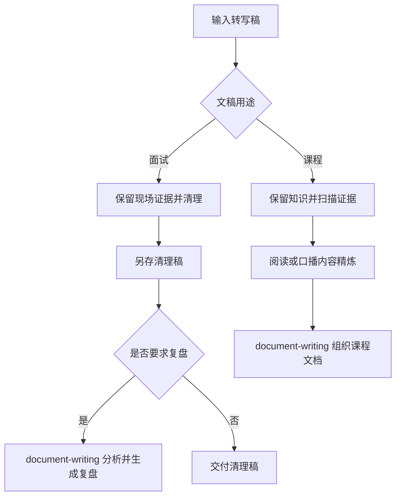

# 设计文档

## 重点

- **双场景**：面试清理保留现场证据，课程精炼保留教学完整性。
- **职责分离**：本 skill 负责转写处理，`document-writing` 负责成文和面试分析。
- **按需加载**：通过场景引用隔离删改规则，默认生成正式清理稿；面试正文不保留来源锚点。

## 一、项目简介与目标

- 项目名称：`transcript-refine`
- 目标：清理面试转写稿，或将课程转写稿精炼为首次学习材料。
- 核心价值：按用途保留证据或知识，课程提供阅读稿与口播稿。

## 二、模块边界

- 输入模块：原始转写稿（主输入）+ 可选证据源（PDF/TXT/代码）。
- 共同处理：保序、分段、标点、识别纠错和术语统一。
- 面试分支：按原始顺序逐问逐答，保留回答细节、错误判断、犹豫、遗漏及原始问答关系，不加入分析。
- JD 分支：将岗位信息、职责、要求、加分项和公司介绍转换为可读的 Markdown 分区与列表，不改变原始事实。
- 课程分支：知识完整、教学解释、案例保留、证据扫描与精细引用。
- 输出：面试清理稿，或课程阅读稿与口播稿；面试仅维护一份正文干净、
  不含原稿定位信息的正式清理稿。
- 成文交接：课程内容由 `document-writing` 编排；用户要求复盘时再交接面试材料。
- 文档模块：`project-docs` 三文档维护。

## 三、核心流程

先判断用途，再加载对应细则，避免两种场景的删改规则相互影响。

## 四、架构决策记录

### 4.1 ADR-20261010-按用途拆分清理与成文

- **决策**：保留一个转写处理入口，面试与课程细则放在 `references/`；
  面试分析和文档呈现集中到 `document-writing`。
- **原因**：共同清理动作复用，场景的删改边界独立维护。
- **交接数据**：原稿与处理稿路径、真实定位、未决片段、上下文和用户所选格式。
- **分发**：两者同属 `content-skills`，`interview-skills` 只提供模拟面试。

### 4.2 ADR-20260323-迁移到project-docs三文档

#### 4.2.1 状态

已采纳

#### 4.2.2 背景

历史版本变更以单一 `changelog.md` 记录，缺少设计与面试沉淀的统一位置，跨阶段维护
成本高。

#### 4.2.3 决策

统一采用 `project-docs/design.md`、`project-docs/changelog.md`、
`project-docs/resume-interview.md`。

#### 4.2.4 影响

- 优点：
  - 设计、变更、复盘视角分离清晰。
  - 长周期维护时信息检索效率更高。
- 缺点：
  - 迁移初期需要一次性整理历史条目。

### 4.3 ADR-20261022-面试逐问逐答与JD结构化渲染

#### 4.3.1 状态

已采纳

#### 4.3.2 背景

按主题归纳会把多个独立问题合并到同一小节，并用第三人称摘要替代候选人的
真实讲述，导致项目流程、失败处理、面试官纠正和自我修正等现场证据丢失。
同时，整份 JD 使用缩进文本或引用块呈现时，职责、要求和加分项难以扫描。

#### 4.3.3 决策

面试清理默认采用逐问逐答结构：面试官每个主问题或独立追问分别形成
一个问答单元，候选回答保留原有信息链；仅同一次发言中的多个子问保持在同一单元。
岗位 JD 使用 Markdown 标题、概览表、段落和逐条列表呈现，不改变原始条目和事实。

#### 4.3.4 影响

- 优点：
  - 保留真实面试节奏，方便题目级复盘和追问链追踪。
  - JD 的层级、职责和要求更易读，减少漏项。
- 代价：
  - 清理稿会比主题摘要更长。
  - 需要明确判断“同一次发言中的子问”和“后续独立追问”的边界。

### 4.4 ADR-20261022-面试清理稿去除来源锚点

#### 4.4.1 状态

已采纳

#### 4.4.2 背景

来源路径、“原稿行”和原始时间戳范围会进入交付正文，但用户后续只保留
清理稿并删除 TXT。继续展示这些锚点会让文档引用不存在的文件，也会打断阅读。

#### 4.4.3 决策

面试清理稿正文不输出源文件路径、“原稿行”、原始行范围、时间戳范围或
“原稿见……”说明；定位信息只用于整理时内部核对。用户要求只保留清理稿时，
删除已被替代的 TXT，不生成带数字后缀的重复清理稿。

#### 4.4.4 影响

- 优点：交付稿可直接阅读，不再包含失效引用。
- 代价：清理后的正文无法仅凭文档反查原稿位置，需在清理完成前完成核对。
