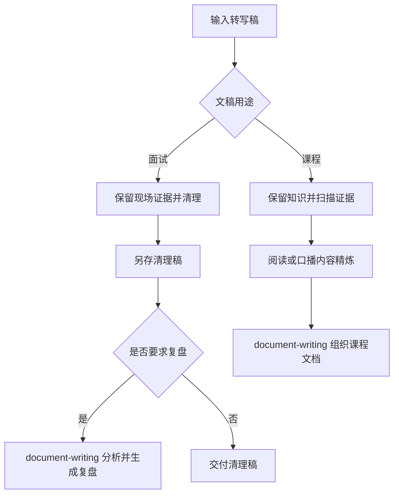

# 设计文档

## 重点

- **双场景**：面试清理保留现场证据，课程精炼保留教学完整性。
- **职责分离**：本 skill 负责转写处理，`document-writing` 负责成文和面试分析。
- **按需加载**：通过场景引用隔离删改规则，默认另存结果并保留原稿。

## 一、项目简介与目标

- 项目名称：`transcript-refine`
- 目标：清理面试转写稿，或将课程转写稿精炼为首次学习材料。
- 核心价值：按用途保留证据或知识，课程提供阅读稿与口播稿。

## 二、模块边界

- 输入模块：原始转写稿（主输入）+ 可选证据源（PDF/TXT/代码）。
- 共同处理：保序、分段、标点、识别纠错和术语统一。
- 面试分支：保留错误判断、犹豫、遗漏及原始问答关系，不加入分析。
- 课程分支：知识完整、教学解释、案例保留、证据扫描与精细引用。
- 输出：面试清理稿，或课程阅读稿与口播稿；默认另存。
- 成文交接：课程内容由 `document-writing` 编排；用户要求复盘时再交接面试材料。
- 文档模块：`project-docs` 三文档维护。

## 三、核心流程

先判断用途，再加载对应细则，避免两种场景的删改规则相互影响。

## 四、架构决策记录

### 4.1 ADR-20261010-按用途拆分清理与成文

- **决策**：保留一个转写处理入口，面试与课程细则放在 `references/`；
  面试分析和文档呈现集中到 `document-writing`。
- **原因**：共同清理动作复用，场景的删改边界独立维护。
- **交接数据**：原稿与处理稿路径、真实定位、未决片段、上下文和用户所选格式。
- **分发**：两者同属 `content-skills`，`interview-skills` 只提供模拟面试。

### 4.2 ADR-20260323-迁移到project-docs三文档

#### 4.2.1 状态

已采纳

#### 4.2.2 背景

历史版本变更以单一 `changelog.md` 记录，缺少设计与面试沉淀的统一位置，跨阶段维护
成本高。

#### 4.2.3 决策

统一采用 `project-docs/design.md`、`project-docs/changelog.md`、
`project-docs/resume-interview.md`。

#### 4.2.4 影响

- 优点：
  - 设计、变更、复盘视角分离清晰。
  - 长周期维护时信息检索效率更高。
- 缺点：
  - 迁移初期需要一次性整理历史条目。
